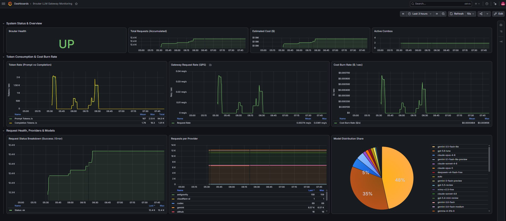

# 9router LLM Gateway Prometheus Exporter & Grafana Dashboard

Monitoring setup for 9router LLM Gateway, tracking request rates, token consumption (prompt vs. completion), cost burn rates, provider distribution, and model share.

## Dashboard Preview



## Components

1. **`exporter.py`**: Python Prometheus exporter running on port `9109` that queries 9router's SQLite database (`/root/.9router/db/data.sqlite`) and health endpoint.
2. **`dashboard.json`**: Complete Grafana dashboard JSON configuration.

## Metrics Exposed

- `router9_up`: Health status of 9router API
- `router9_usage_total_requests`: Total requests logged
- `router9_usage_prompt_tokens_total`: Total prompt tokens consumed
- `router9_usage_completion_tokens_total`: Total completion tokens consumed
- `router9_usage_cost_usd_total`: Total estimated cost in USD
- `router9_provider_requests_total`: Requests per provider (labeled by provider)
- `router9_provider_tokens_total`: Tokens per provider and token type
- `router9_model_requests_total`: Requests per model
- `router9_status_requests_total`: Requests by HTTP/status code
- `router9_combos_total`: Total active model combos

## Installation & Running

### 1. Run the Exporter
```bash
python3 exporter.py
```

### 2. Import Grafana Dashboard
Import `dashboard.json` into your Grafana instance connected to Prometheus.
